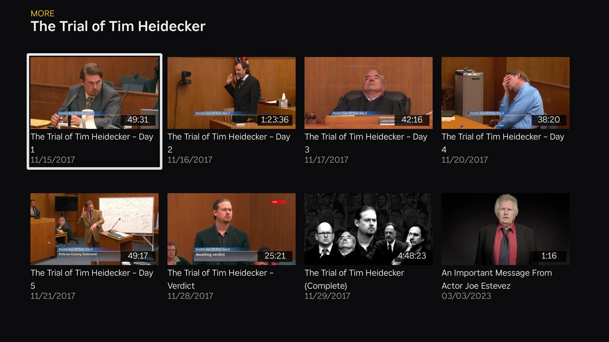

# HEI Network for Roku (unofficial)

*On Cinema at the Roku.*

Hello hobbit-heads! I present a Roku channel for watching [HEI Network](https://www.heinetwork.tv/). It is a port of
[dvanders/hei-network-webos](https://github.com/dvanders/hei-network-webos), the LG webOS app, to
BrightScript and SceneGraph.

**This is an unofficial, fan-made client.** It is not affiliated with, endorsed by, or supported by
HEI Network. You need your own HEI Network account, and this channel can only play content your account would already have access to.



## What it does

- Home screen with the featured episode, "Continue watching", the latest seasons and a browse row
- Browse shows, seasons and episodes with the remote
- Access to every five-bagger review and every Merk Proksx impression
- Sign in with a QR code or activation code confirmed on your phone; no password typed on the TV
- Player (Roku's standard one) that resumes where you left off, syncs progress with your account,
  and plays the next episode automatically

## Remote controls

Exactly what you'd expect from a Roku

## Installing

The channel is not in the Roku store, so it is sideloaded through Developer Mode.

1. On the Roku remote press Home x3, Up x2, Right, Left, Right, Left, Right. Enable the installer,
   set a password, and note the IP address it shows.
2. Download `hei-roku.zip` from the [latest release](https://github.com/stereoabuse/hei-roku/releases/latest),
   or build it yourself (see below).
3. Open `http://<roku-ip>` in a browser, sign in as `rokudev` with your password, upload the zip
   and choose **Install**.

Only one sideloaded channel can be installed at a time.

## Building

Requires Node.js.

```sh
npm install
npm run build        # checks the code and writes out/hei-roku.zip
```

To build and install in one step:

```sh
npx bsc --deploy --host <roku-ip> --password <dev-password>
```

Debug output (`print` statements, crashes) is on `telnet <roku-ip> 8085`.

The icon and splash screen are generated by `uv run tools/make_images.py`.

## How it works

The channel talks to the REST API the official HEI Network apps use
(`https://www.heinetwork.tv/wp-json/hei-app/v1`). The catalogue is public, sign-in uses the site's activation-code flow, and stream URLs are only returned for a signed-in account. Watch progress is read from and saved to the site's `video-progress/v1` endpoints. The login token is stored only in the channel's registry on your Roku.

Because this relies on an API that is not documented for third parties, it can break whenever the site changes.

## Licence

MIT; see [LICENSE](LICENSE). Derived from hei-network-webos by Dan van der Ster. "HEI Network" and
"On Cinema at the Cinema" are the property of their respective owners; this project claims no
rights to them and ships none of their artwork.
